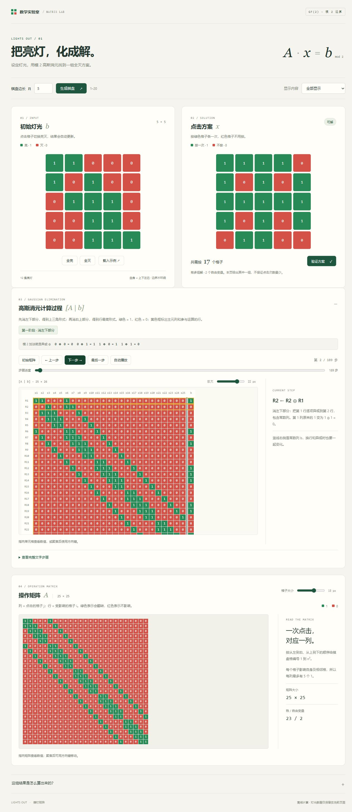

# 熄灯矩阵

一个可离线运行的熄灯问题网页实验室。设置 1～20 阶棋盘的初始灯光，程序用模 2 高斯消元给出一组可行的点击方案，并逐步展示操作矩阵和消元过程。多解时提供其中一组方案；无解时会明确提示。

双击打开 `dist/index.html` 即可使用，无需安装依赖或连接网络。点击左侧格子设置亮灯，右侧查看点击方案；可以回放消元步骤并验证方案。



## 开发与验证

使用 Node.js 运行：

```powershell
node scripts/build.mjs
node --test tests/*.test.cjs
```

源码在 `src/`，自动化测试在 `tests/`，需求与设计记录在 `doc/`。`package.json` 的 `private: true` 只阻止误发布到 npm，与 GitHub 仓库可见性无关。

本仓库目前公开可见，但尚未提供复用许可证。网页尚未接入游戏大厅。
